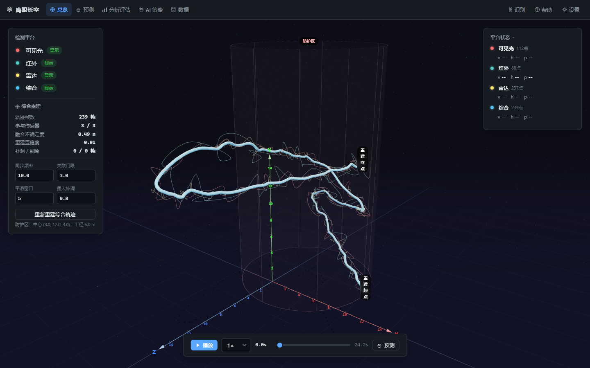

# 端到端验收

本目录保存验收脚本、报告与截图，覆盖两条线：

- **数值/预测精度**：`run_acceptance.py` —— 用留出真值检查"预测出后续坐标"，并与线性外推对照；
- **集成链路**：`run_collab_acceptance.py` —— 检查页面、综合重建、预测联动、分析评估、
  隐藏平台播放与参数持久化，产物为 `collab_report.json` 与四张截图。

## 前置条件

```powershell
# 1) 权重：训练产物或手动放入 models/kinflow（推理服务会按顺序查找）
python train/kinflow_predictor/train.py --smoke

# 2) 启动软件（conda 环境 drone）
D:\Anaconda3\envs\drone\python.exe -m trajectory_reconstruction --headless   # :5000

# 3) 运行（依赖 playwright + chromium）
D:\Anaconda3\envs\drone\python.exe docs/acceptance/run_collab_acceptance.py
D:\Anaconda3\envs\drone\python.exe docs/acceptance/run_acceptance.py
```

> `run_acceptance.py` 会通过 `/api/load_data` 把截断轨迹上传为"自选"平台并生成
> `kinflow_predict_*.png`；完成后重启服务可清除该临时平台。

## 当前指标（2 s 视界模型）

| 指标 | 数值 |
|------|------|
| 测试集 ADE / FDE | **0.495 m / 1.324 m** |
| minADE_8（σ=0.1） | 0.455 m |
| 测试轨迹 80% 切点（20 条） | KinFlow ADE 0.47 m vs 线性 1.85 m |
| 演示真值 5 个切点 | KinFlow ADE 1.71 m vs 线性 2.64 m |

长视界（运动模型外推）：5 s / 10 s / 20 s 位移分别约 17.9 / 35.0 / 68.6 m，
末端置信度 0.69 / 0.37 / 0.15。

## 集成验收检查项（最近一次）

| 检查项 | 结果 |
|--------|------|
| 页面可达（/ /predict /analysis/ /ai /data /settings /docs） | 全部 200 |
| 总览综合重建 | mode=reconstruction，239 帧，3/3 传感器，一致帧 100%，σ=0.49 m，置信度 0.91 |
| 预测联动 | 默认目标"综合"，显示重建来源、视界提示与末端置信度 |
| 长视界 | 20 点 × 0.5 s（10 s）可生成，末端置信度 0.37 |
| 最佳捕捉时机 | 预测后返回 3 个候选（按得分） |
| 风险分析评估 | 六因子 + 时间线 + 建议，预测来源 KinFlow |
| 隐藏平台播放 | 隐藏平台的目标球不再出现（dashboard_playback_hidden.png） |
| 重建参数持久化 | 改 Hz/门限/窗口/补洞后刷新仍保持 |
| 浏览器控制台 | 0 错误 |

## 产物

| 文件 | 说明 |
|------|------|
| `collab_report.json` | 集成验收完整数据（接口、页面、截图路径） |
| `dashboard_recon.png` | 总览：防护区 + 综合重建面板 + 青色重建轨迹 |
| `dashboard_playback_hidden.png` | 隐藏"可见光"后播放的截图 |
| `predict_linked.png` | 预测：综合轨迹联动、视界与置信度 |
| `analysis_assessment.png` | 分析评估全页（结论→时间线→因子/建议→证据→捕捉时机→图表） |
| `acceptance_report.json` | 数值验收数据（每步误差、接口返回、页面状态） |
| `demo_truth.npz` | 演示数据的真值轨迹（供预测误差对照） |


